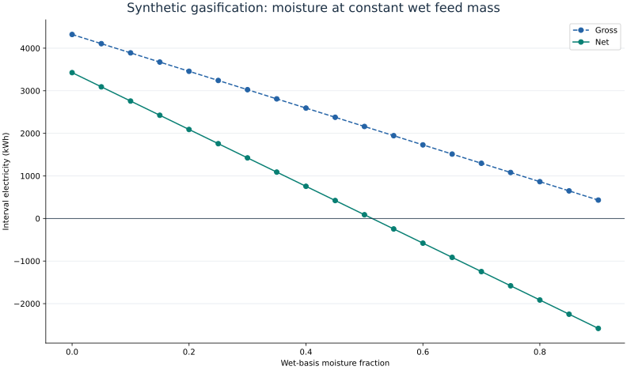
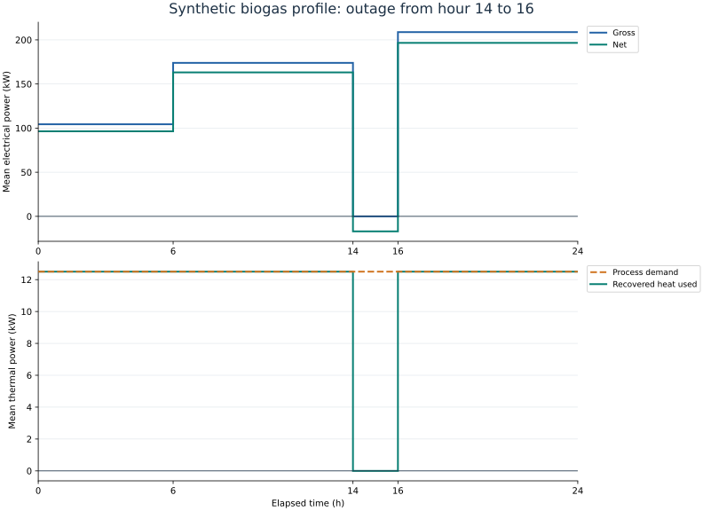

# Plotting and a reproducible worked example

Plotting is an optional layer over the same simulation results used by the CLI and
Python API. It does not change the conversion equations or apply hidden corrections.
Install from the repository with:

```bash
python -m pip install -e '.[plots]'
```

Core simulations still run without Matplotlib. The plotting functions use an
explicit non-interactive canvas, work without a display server, and return a
Matplotlib `Figure` for further customization. No `pyplot` global figure manager
or GUI backend is initialized.

## One scenario from the CLI

```bash
x2power plot use_cases/scenarios/biomass_gasification.json -o results/energy_balance.svg
```

The file extension selects PNG, SVG or PDF. Missing parent directories are created.
An unsupported extension or missing plotting dependency returns a clear CLI error.

## Python API

```python
from x2power.scenario import run_scenario
from x2power.utilities.io import load_scenario
from x2power.utilities.plotting import plot_energy_balance, save_figure

config = load_scenario("use_cases/scenarios/biomass_gasification.json")
result = run_scenario(config)
figure = plot_energy_balance(result, title="Synthetic gasification example")
save_figure(figure, "results/energy_balance.png", dpi=180)
```

| Function | Input | Interpretation |
| --- | --- | --- |
| `plot_energy_balance` | One `SimulationResult` | Signed electrical deductions and thermal heat allocation |
| `plot_sensitivity` | Rows returned by `sweep_parameter` | Gross/net interval electricity versus one numeric input |
| `plot_profile` | Sequence returned by `simulate_profile` | Interval-mean power against actual elapsed hours |
| `plot_uncertainty` | Sequence of sampled net kWh | Histogram counts and empirical p05/p50/p95 values |
| `save_figure` | Figure and output path | PNG/SVG/PDF export with optional DPI |

## Worked example

```bash
python use_cases/visual_report.py --output-dir results/visual_report
```

The script uses three existing synthetic configurations and produces four figures:

1. **Electricity and process heat.** The gasification case starts with gross
   generation, deducts auxiliaries and electric-heater consumption, and ends at net
   electricity. Deductions have negative signs; negative net output is preserved.
   The heat panel distinguishes recovered heat used, recovered heat not used and
   heat supplied by the electric heater. Electrical heater input and delivered
   thermal heat differ when heater efficiency is below one.
2. **Moisture sensitivity.** Wet feed remains fixed at 4000 kg over 24 h. Moisture
   increases from 0 to 0.9 in steps of 0.05. Less dry material means less chemical
   energy, while more water increases evaporation duty. The net curve can cross
   zero even while gross generation remains positive. These are steady calculations
   with fixed recovery/efficiency parameters, not a stability prediction for a reactor.
3. **Operating profile.** Biogas flow changes over intervals of 6, 8, 2 and 8 hours.
   A generator outage occupies hours 14–16. The plot uses the true interval widths;
   electrical power multiplied by each duration recovers that interval's energy.
   Feed processing and standing loads continue during the outage, producing negative
   net output and unused fuel. There is no assumed gas storage.
4. **Uncertainty sampling.** Food-waste digestion is evaluated 1000 times with seed
   42. VS destruction, methane yield and generator efficiency are sampled independently
   from the script's uniform bounds. Quantiles describe those assumed distributions,
   not measured confidence in equipment performance.





## Output files and reproducibility

| Output | Contents |
| --- | --- |
| `energy_balance.png` / `.svg` | Electrical waterfall and heat allocation |
| `moisture_sensitivity.png` / `.svg` | Gross and net electricity across moisture values |
| `operating_profile.png` / `.svg` | Electrical and thermal powers over elapsed time |
| `uncertainty.png` / `.svg` | Sample distribution and empirical quantiles |
| `moisture_sensitivity.csv` | Input fraction, gross/net kWh and mean net kW |
| `operating_profile.csv` | Start/end hours and mean electrical/thermal powers |
| `results.json` | Input configurations, settings, simulator version, full results and all draws |

The example can run from any working directory after package installation. It
resolves input files relative to the script and writes to the requested output
directory. Rerunning with the same code and inputs reproduces the numerical JSON.
Rendered pixels may vary with Matplotlib, fonts and platform versions. SVG element
identifiers are stable and generated timestamps are suppressed on SVG/PDF export.

The figures in this documentation are generated by the same script; they are not
manually drawn. To refresh them, run the example and copy only its
`moisture_sensitivity.svg` and `operating_profile.svg` into `docs/figures/`.
Keep the full generated datasets in `results/`, which is excluded from version control.

See [model equations and limitations](models.md) and [validation guidance](validation.md)
for the physical assumptions. The rendering implementation follows the public
[Matplotlib Figure API](https://matplotlib.org/stable/api/figure_api.html) and
[non-interactive canvas example](https://matplotlib.org/stable/gallery/user_interfaces/canvasagg.html).
